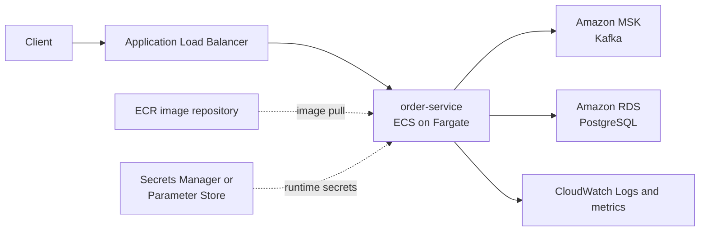

# Lesson 6 — AWS container foundation

Time box: 90 minutes.

## Outcome

Package `order-service` as a production-style container and understand where it
will run in AWS. By the end of this lesson, we will have:

- a locally built Docker image for the Spring Boot service;
- a clear distinction between build-time and runtime configuration;
- a cost-aware AWS deployment map;
- an AWS budget guardrail;
- optionally, the image stored in a private Amazon ECR repository.

We will not create ECS, RDS, MSK, a load balancer, or a NAT Gateway today.
Those resources can incur ongoing charges and belong in later, deliberately
time-boxed exercises.

## Refresh from Lesson 5

- A retry is another processing attempt. Recovery is the terminal action after
  retries are exhausted—or immediately for a non-retryable exception. Publishing
  to a DLT is one possible recovery action; reading and replaying a DLT is a
  separate operational workflow.
- `FixedBackOff(500L, 2L)` gives one initial attempt and two retries: three
  listener invocations in total.
- Blocking backoff occupies the listener container's consumer thread. It lowers
  throughput and can cause a rebalance if processing keeps the consumer away
  from `poll()` longer than `max.poll.interval.ms`.
- A permanent business error should normally skip retry because repeating the
  same input cannot repair it.
- A malformed payload fails while bytes are being deserialized, before the
  typed listener receives an `OrderCreated`. `ErrorHandlingDeserializer`
  captures the failure and raw record context so the container's error handler
  can recover it, for example to a DLT.

## Target architecture



Service responsibilities:

| Service | Responsibility in this project |
| --- | --- |
| ECR | Stores immutable container-image versions. |
| ECS | Defines and supervises the running service and its tasks. |
| Fargate | Supplies managed compute for each ECS task. |
| MSK | Supplies managed Kafka brokers. |
| RDS | Supplies managed PostgreSQL. |
| CloudWatch | Collects application logs, metrics, and alarms. |
| IAM | Grants only the permissions each AWS actor needs. |

Two ECS roles must not be confused:

- The **task execution role** lets the ECS/Fargate infrastructure pull the
  image from ECR, deliver logs, and resolve referenced secrets.
- The **task role** gives the application code inside the container permission
  to call AWS APIs. Kafka and PostgreSQL network connections are not themselves
  granted by this role; routing, security groups, credentials, and each
  service's authentication rules control those connections.

## Cost guardrail

Before provisioning infrastructure, create a small monthly AWS cost budget with
both an actual-cost alert and a forecasted-cost alert. A budget is an alerting
mechanism, not a hard spending cap, and billing data is not real-time.

For this learning project, treat these as explicit-cost resources that must be
created only for a planned lab and deleted or scaled down afterward:

- MSK clusters;
- RDS database instances;
- NAT Gateways, which are billed for availability and data processing;
- ECS/Fargate tasks and load balancers.

## Exercise A — build the application artifact

Run the test suite and package the executable Spring Boot JAR:

```powershell
mvn clean package
```

If `mvn` is not available in PowerShell's `PATH`, this project can use the
Maven installation bundled with IntelliJ on this workstation:

```powershell
& "C:\Program Files\JetBrains\IntelliJ IDEA Community Edition 2023.1.3\plugins\maven\lib\maven3\bin\mvn.cmd" clean package
```

The leading `&` is PowerShell's call operator; it executes a path containing
spaces. A later project improvement will be to add Maven Wrapper files so the
build can use `./mvnw.cmd` without depending on a machine-specific Maven path.

Confirm that this file exists:

```text
target/order-service-0.0.1-SNAPSHOT.jar
```

The JAR is the application artifact. A Docker image will add the Java runtime,
an operating-system layer, a non-root user, and the command that launches it.

## Exercise B — write a production-style Dockerfile

Create `Dockerfile` in the project root:

```dockerfile
FROM eclipse-temurin:21-jre-jammy

WORKDIR /app
RUN useradd --system --uid 10001 appuser

COPY --chown=appuser:appuser target/order-service-0.0.1-SNAPSHOT.jar app.jar

USER appuser
EXPOSE 8080
ENTRYPOINT ["java", "-jar", "/app/app.jar"]
```

Why each choice matters:

- `21-jre` contains the runtime needed to execute the app, without a full JDK.
- `WORKDIR` gives the process a predictable filesystem location.
- `USER appuser` avoids running application code as root.
- `EXPOSE` documents the application port; it does not publish that port.
- exec-form `ENTRYPOINT` makes Java the container process and lets it receive
  termination signals correctly.

Build and inspect the image:

```powershell
docker build -t order-service:session-06 .
docker image inspect order-service:session-06
docker run --rm --entrypoint java order-service:session-06 -version
```

The final command verifies the image's Java runtime without starting Spring.

## Exercise C — separate image correctness from runtime correctness

Try to start the service and retain the first meaningful error:

```powershell
docker run --rm --name order-service-session-06 order-service:session-06
```

A successful image build does not prove that the service can start. At runtime,
the container still needs valid configuration and reachable dependencies.
Inspect `application.yml` and answer:

1. Is the active-profile property spelled using Spring Boot's expected key?
2. Which `ProcessedEventStore` bean exists with the active profile?
3. What does `localhost:29092` mean from inside the service container?
4. Where will JDBC obtain its URL, username, and password?
5. Which settings should be provided by the deployment environment instead of
   baked into the image?

Do not fix all of these yet. Capture the failure first; then we will externalize
configuration and add a container-level startup/health check.

## Exercise D — AWS identity and budget safety check

Before creating resources, verify which identity and Region the CLI will use:

```powershell
aws sts get-caller-identity
aws configure get region
```

Do not paste AWS credentials or the full account ID into notes or chat. In the
AWS Billing console, create a monthly cost budget and alerts appropriate for
your learning limit. Record only:

- the budget name;
- alert thresholds;
- the chosen AWS Region;
- why budgets do not guarantee a hard cap.

## Exercise E — publish the image to ECR

Only after the budget is configured, create one private ECR repository. Replace
the placeholders rather than copying them literally:

```powershell
aws ecr create-repository --repository-name order-service --region <region>
aws ecr get-login-password --region <region> | docker login --username AWS --password-stdin <account-id>.dkr.ecr.<region>.amazonaws.com
docker tag order-service:session-06 <account-id>.dkr.ecr.<region>.amazonaws.com/order-service:session-06
docker push <account-id>.dkr.ecr.<region>.amazonaws.com/order-service:session-06
```

Prefer a versioned or commit-based image tag for deployments. A mutable
`latest` tag does not uniquely identify what code is running.

## Interview debrief

Be ready to answer:

1. What is the difference between an image and a running container?
2. Why should runtime configuration not be baked into the image?
3. Why run the application as a non-root user?
4. What is the difference between an ECS task execution role and task role?
5. Why can a Docker build pass while container startup fails?
6. What does `localhost` mean inside a container?
7. What does ECR provide, and what does ECS provide?
8. Why is an AWS Budget useful but not a hard spending limit?

## References

- [Amazon ECR image lifecycle with the AWS CLI](https://docs.aws.amazon.com/AmazonECR/latest/userguide/getting-started-cli.html)
- [IAM roles for Amazon ECS](https://docs.aws.amazon.com/AmazonECS/latest/developerguide/ecs-iam-role-overview.html)
- [Creating an AWS Budget](https://docs.aws.amazon.com/cost-management/latest/userguide/budgets-create.html)
- [AWS Budgets best practices and update frequency](https://docs.aws.amazon.com/cost-management/latest/userguide/budgets-best-practices.html)

## Session summary

- Maven produced the executable Spring Boot JAR, and a Dockerfile packaged it
  with a Java 21 runtime. The container runs as UID `10001` rather than root.
- An image is an immutable package; a container is a running process created
  from that image. `docker build` validated the packaging instructions but did
  not prove that Spring had valid runtime configuration or reachable services.
- The first startup failure exposed profile-based dependency injection: without
  `database` or `in-memory`, Spring had no `ProcessedEventStore`. The next
  failure exposed the missing JDBC URL. Startup failures can surface one layer
  at a time.
- `localhost` inside a container refers to that container's own network
  namespace. Docker Compose provides internal DNS, so the application connects
  to `kafka:9092` and `postgres:5432` by service name.
- Runtime environment variables select the Spring profile and provide Kafka and
  JDBC locations. This lets the same image move between local, test, and AWS
  environments without rebuilding it or embedding environment-specific values.
- An end-to-end check proved the deployed local flow: Actuator returned `UP`,
  `POST /orders` returned an `orderId` and `eventId`, Kafka acknowledged and
  delivered the event, and the consumer committed the matching PostgreSQL row.
- A personal AWS Free-plan account was protected with root MFA and a zero-spend
  budget. Root was used only for account bootstrap. The daily CLI identity is
  `learning-developer`, authenticated with temporary `aws login` credentials
  and restricted to ECR operations rather than account-wide permissions.
- ECR stores container images; ECS defines and supervises running container
  workloads. An ECR repository named `order-service` was created with immutable
  tags, and `order-service:session-06` was pushed successfully at approximately
  138.4 MiB compressed.
- Docker Desktop's Windows credential helper could not store the ECR token. The
  push used an isolated temporary Docker configuration, and the directory was
  verified deleted afterward so the short-lived token did not remain on disk.
- Future ECS deployments will distinguish the task execution role, used by ECS
  to pull images and deliver logs, from the task role, whose temporary
  permissions are available to the application code inside the container.

